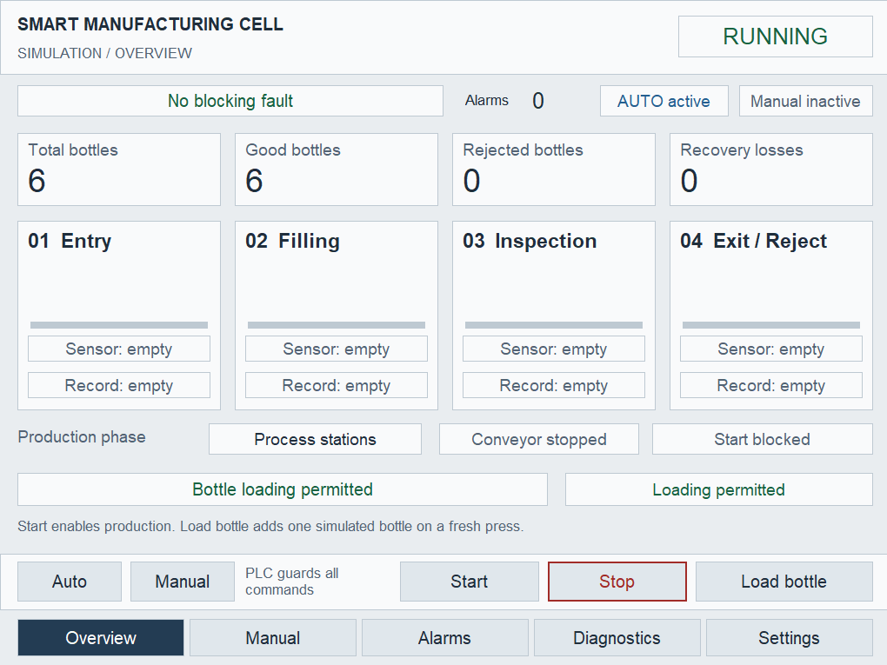
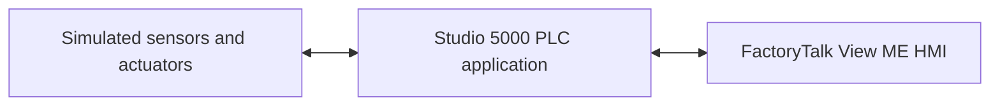
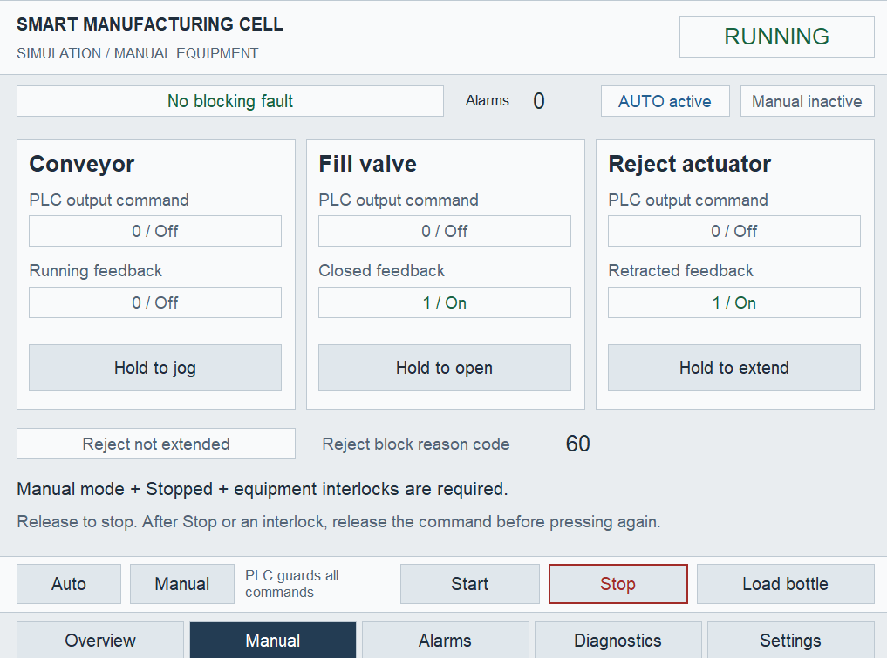
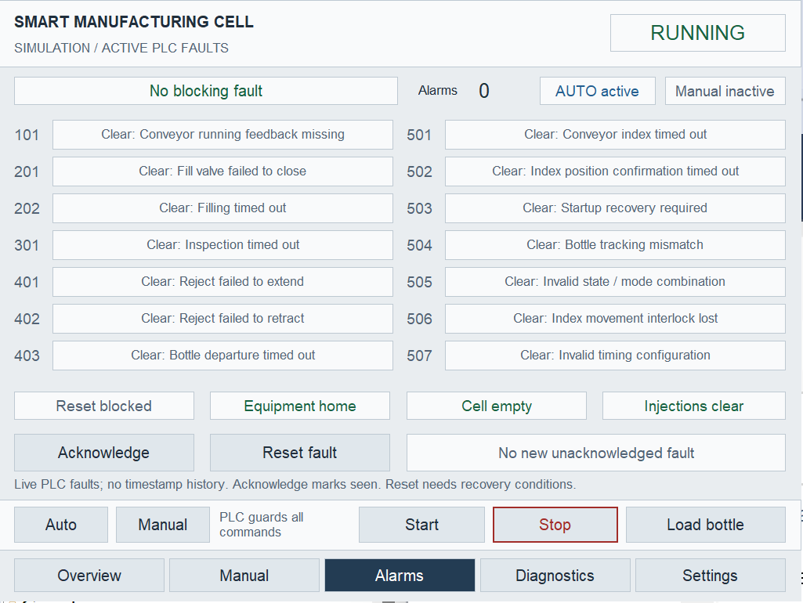
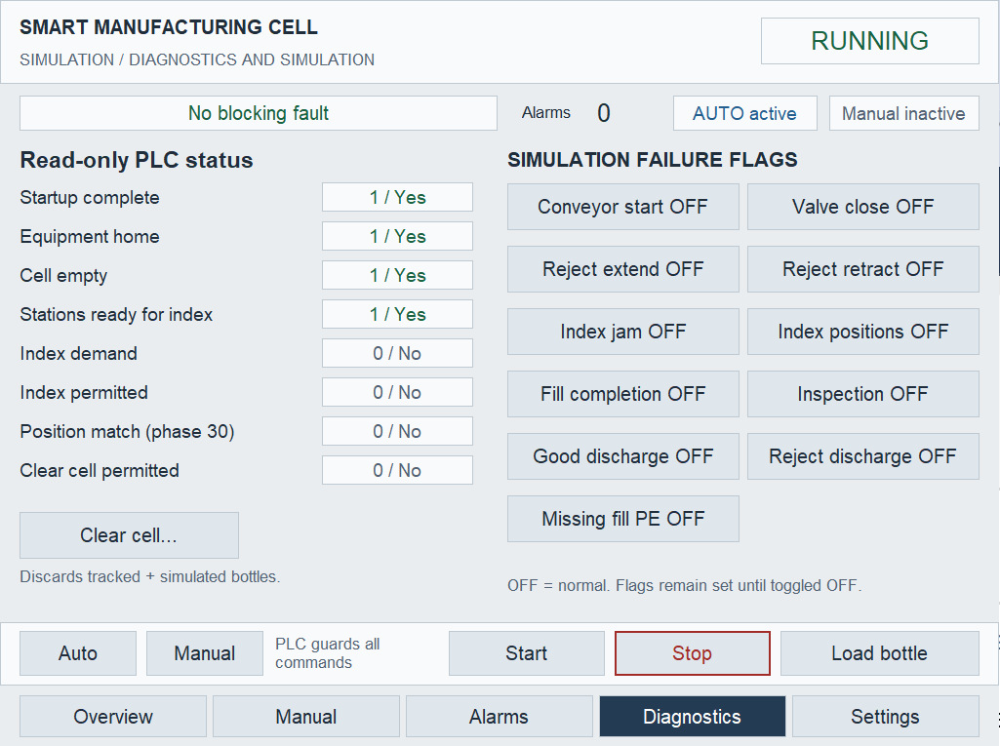
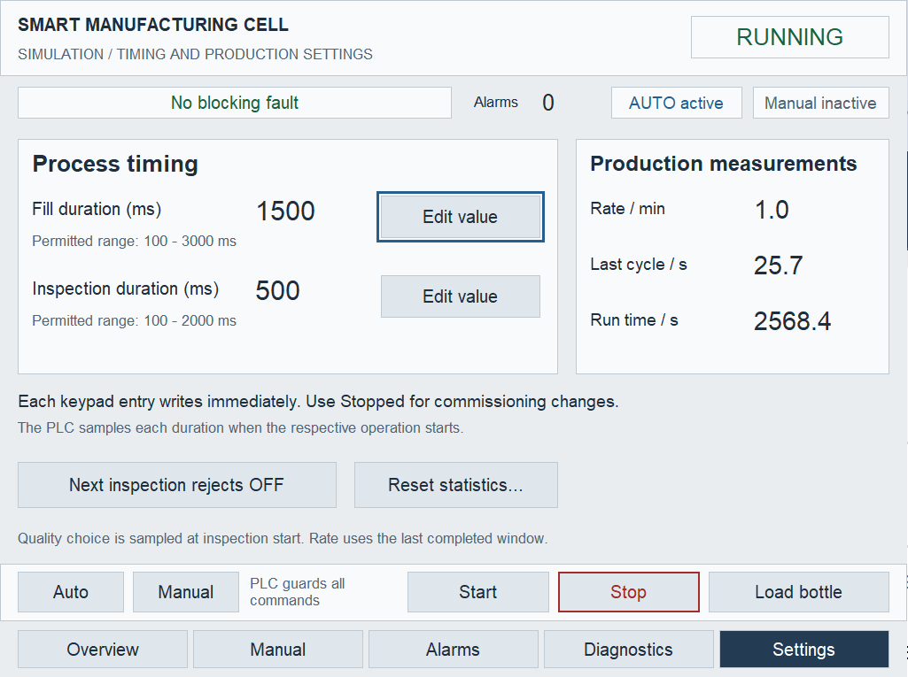

# Smart Manufacturing Cell

A simulated bottle filling and inspection cell built with **Studio 5000, Logix Emulate, and FactoryTalk View ME**. This portfolio project delivers PLC sequencing, equipment interlocks, fault recovery, bottle tracking, production statistics, and a five-screen operator HMI.

The focus is practical automation engineering: explicit state transitions, predictable scan order, separation of commands and feedback, and diagnostics that explain why an operation is blocked.



*Captured HMI session: Running in Auto, 6 total bottles, 6 good, 0 rejected, and 0 recovery losses. The empty cell waits for another bottle.*

## Delivered scope

| Area | Deliverable |
|---|---|
| PLC application | Modular equipment control, automatic sequencing, bottle tracking and statistics |
| Simulation | Four bottle positions, delayed actuator feedback and configurable failure injection |
| HMI | Overview, Manual, Alarms, Diagnostics and Settings, plus two confirmation popups |
| Engineering artifacts | L5X source, readable routines, HMI XML, tag/alarm catalogs and screenshots |
| Validation tools | Static checks, an idealized LD/ST scan model, and native HMI XML schema checks |

The portfolio scope is the PLC-controlled simulated cell and its FactoryTalk HMI. External data acquisition, databases and web applications are outside this version's scope.

## What the cell does

```text
Entry [0]  →  Filling [1]  →  Inspection [2]  →  Exit / Reject [3]
                                                    ├─ Good discharge
                                                    └─ Reject discharge
```

1. An accepted Load Bottle request creates one bottle at the available entry position.
2. With the conveyor stationary, occupied filling, inspection, and exit stations process their bottles concurrently.
3. Filling runs for a configured duration. Inspection samples a simulated Pass/Reject result.
4. After the stations finish and equipment is home, the conveyor indexes all bottles by one station.
5. The PLC confirms the destination sensors before transferring bottle records downstream once.
6. Production counts increment on confirmed discharge. Bottles discarded during recovery are counted separately as recovery losses.

An empty cell can remain **Running** while the conveyor is stopped. Running enables automatic production; movement still requires demand and permissives.

## Implemented features

- **Auto/Manual control:** conveyor jog, fill-valve opening, and reject extension with interlocks and release-before-restart arming.
- **Automatic production:** indexed transport, concurrent station processing, sampled inspection results, and separate good/reject discharge paths.
- **Bottle tracking:** `Production_Bottles[0..3]` uses `UDT_Bottle` records containing `Occupied`, `FillComplete`, `InspectionComplete`, and `RejectRequired`.
- **Controlled Stop:** blocks new operations while allowing active operations to complete according to the sequence design.
- **Fault handling:** 14 fault conditions covering equipment timeouts, index confirmation, tracking mismatch, startup recovery, and invalid state/configuration.
- **Recovery:** guarded Reset, separate acknowledgement, and confirmed Clear Cell/statistics-reset requests.
- **Simulation:** delayed actuator feedback, independent simulated bottle occupancy, and eleven failure-injection flags.
- **Statistics:** total/good/reject counts, recovery losses, production rate, cycle time, and accumulated machine-state times.

## Architecture



The simulation runs inside the controller application. FactoryTalk reads controller status and sends operator requests through the `SMC` shortcut. The PLC owns sequencing, permissions, actuator outputs and recovery decisions.

### PLC organization

`MainTask` runs every **20 ms** in this order:

| Program | Responsibility |
|---|---|
| `Program_System` | Startup, modes, machine state, fault aggregation, recovery and start permissives |
| `Program_Conveyor` | Conveyor commands and running-feedback faults |
| `Program_Filling` | Fill sequence, valve control and filling faults |
| `Program_Inspection` | Inspection, reject actuator, exit handling and related faults |
| `Program_Production` | Bottle loading/tracking, index sequencing, statistics and production faults |
| `Program_Simulation` | Actuator feedback, bottle positions, sensors and failure injection |

**Ladder Diagram** handles equipment, permissives, interlocks and faults. **Structured Text** handles bottle tracking, position comparisons and statistics. The language choice follows the task: discrete logic remains easy to troubleshoot, while structured data operations remain concise.

| State tag | Values |
|---|---|
| `Sys_Sts_MachineState` | `0` Stopped · `10` Running · `20` Stopping · `30` Faulted |
| `Production_Sts_SequenceState` | `0` Idle · `10` Process stations · `20` Indexing · `30` Confirm positions |

Each actuator output has one owning writer. HMI requests, PLC output commands, and simulated feedback remain separate—for example, `HMI_Cmd_RejectExtend`, `Sim_Out_RejectExtend`, and `Sim_In_RejectExtended`.

## HMI screens

The HMI uses a **1024 × 768** layout and direct controller references through the **`SMC`** device shortcut. Commands are evaluated by PLC permissives; a visible button does not imply that its request will be accepted.

| Screen | Operator purpose |
|---|---|
| Overview | Machine state, bottle positions, counters and loading/start permissions |
| Manual | Hold-to-operate equipment commands with separate output and feedback indicators |
| Alarms | Active PLC faults, acknowledgement and recovery conditions |
| Diagnostics | Readiness, index conditions, simulation failures and Clear Cell access |
| Settings | Bounded fill/inspection timing, quality selection and production measurements |

Two additional popups confirm **Clear Cell** and **Reset Statistics**. The Alarms screen presents current PLC faults and recovery permissions. Historical alarm logging and trends are outside this version's scope.

<details>
<summary>View Manual, Alarms, Diagnostics and Settings screenshots</summary>

### Manual control



The Manual page can be viewed while Auto is active. Manual equipment operation still requires Manual mode, Stopped state, and the applicable PLC interlocks.

### Active faults and recovery



### Diagnostics and simulation



### Timing and production settings



</details>

These screenshots show the FactoryTalk application. Approximate generated layout previews are kept separately in `hmi/previews/`.

## Software environment

| Component | Project environment |
|---|---|
| PLC engineering | Studio 5000 Logix Designer v33 |
| Controller simulation | Emulate 5570, revision 33.011, virtual chassis slot 4 |
| HMI engineering | FactoryTalk View ME v12 |
| HMI controller shortcut | `SMC` |


Rockwell tools and the applicable activations must be supplied separately. No physical PLC or production equipment is required for this simulation.

## Engineering skills demonstrated

- Organizing a periodic PLC task into equipment, production and simulation programs.
- Designing machine and station states with explicit transition conditions.
- Separating operator commands, output commands, feedback and tracked bottle data.
- Implementing permissives, timeout faults, acknowledgement and guarded recovery.
- Building an HMI that explains readiness and blocked operations.
- Maintaining reviewable automation source exports, documentation and validation tools in Git.

## Simulation scope

This is an educational portfolio project using standard control logic. It is not a safety-rated system or a commissioned application for physical machinery.
